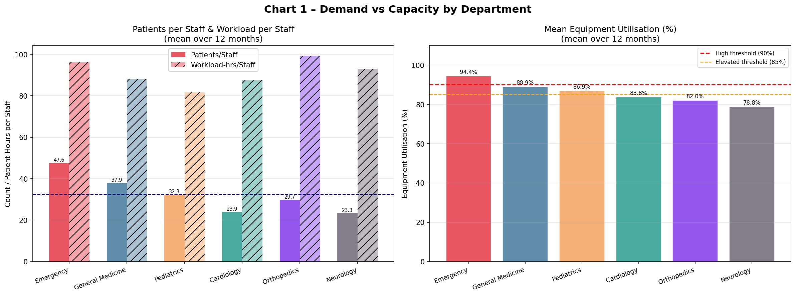
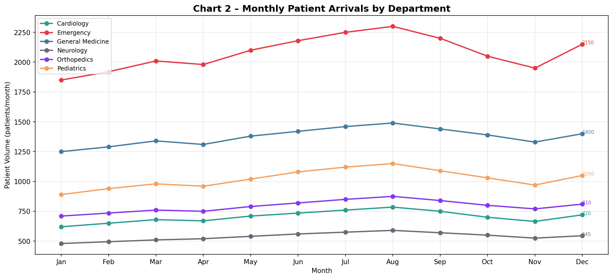
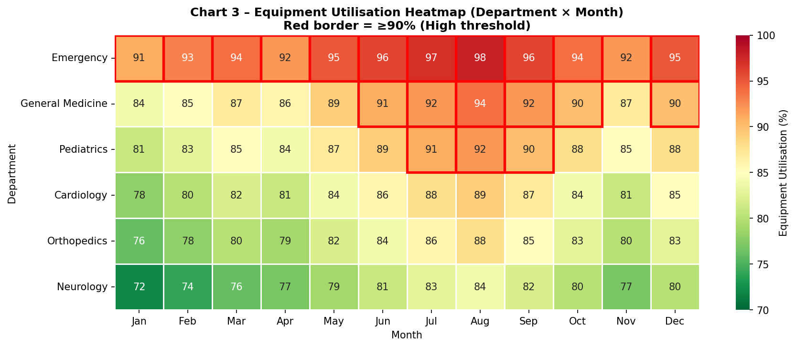
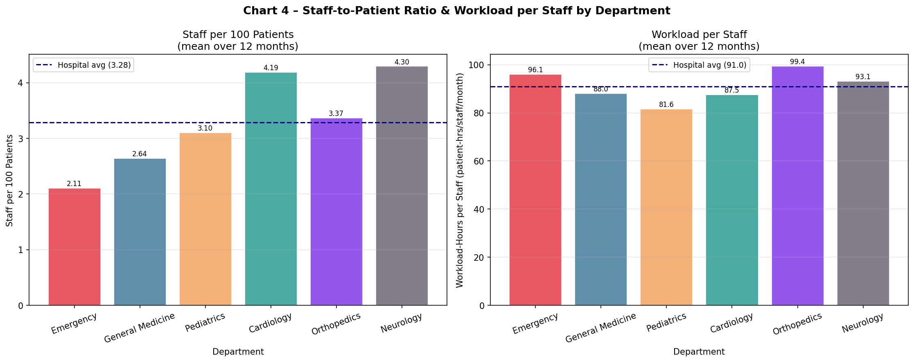
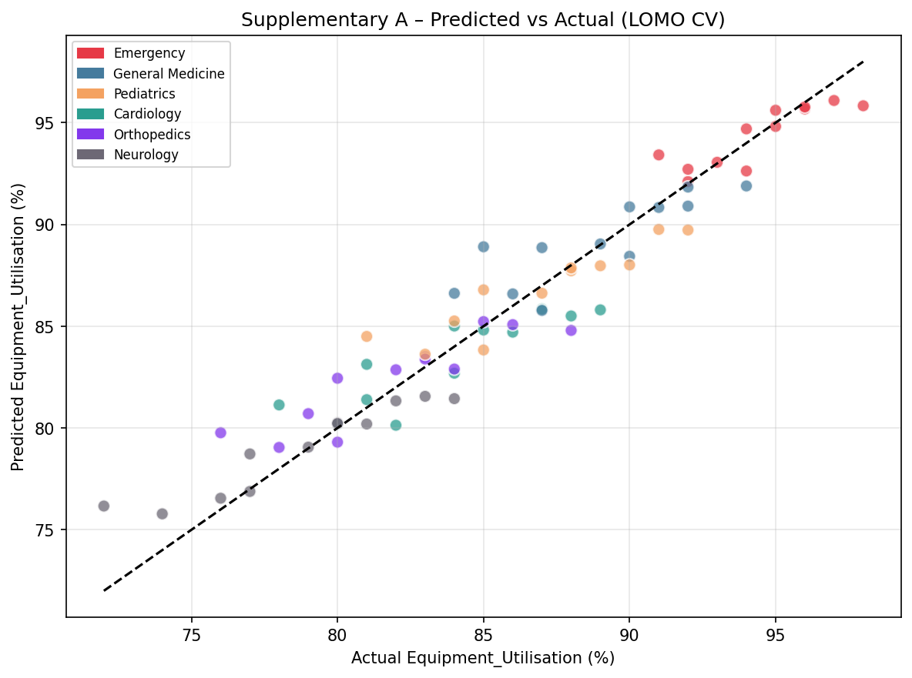
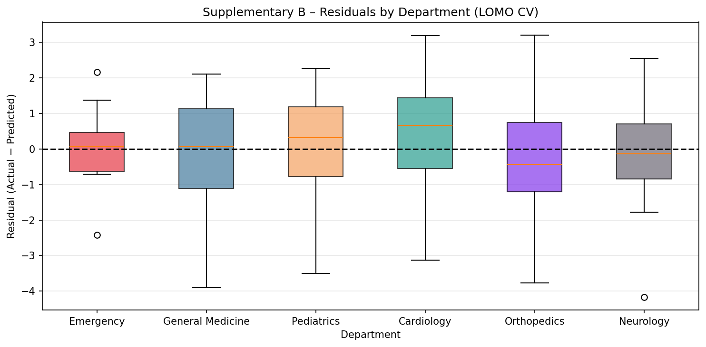
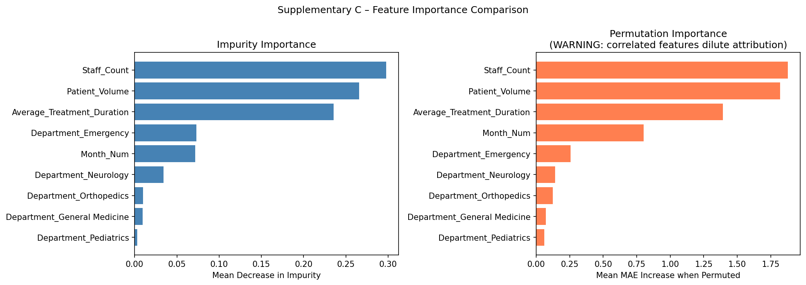

# Hospital Resource Allocation Analysis: Which Department Needs More Resources?
**Senior Data Scientist & Healthcare Operations Analyst Final Report**
**Author:** Antigravity AI – Senior Healthcare Operations Specialist  
**Dataset:** `hospital_resource_allocation (1).csv`  
**Execution Context:** End-to-End Empirical Analysis on Verified Data  

---

## 1. Executive Summary

Hospitals operate under stringent resource constraints where physical equipment saturation and clinical labor strain directly impact clinical outcomes, patient safety, and staff retention. This investigation analyzes a complete 12-month panel dataset across six hospital departments (**Emergency**, **General Medicine**, **Pediatrics**, **Cardiology**, **Orthopedics**, and **Neurology**) to rigorously answer the operational question: **Which department requires more resources, and what form should those resources take?**

### Key Analytical Findings:
1. **Emergency is in Chronic Equipment Saturation**: Emergency displays a mean equipment utilisation of **94.42%** and operates at or above the **90% critical saturation threshold in 100% of months (12/12 months)**, reaching a peak of **98.0% in August**. Emergency is empirically classified as the hospital's sole **Consistently High** equipment utilisation department.
2. **Elevated Secondary Saturation in Inpatient Units**: **General Medicine** (mean **88.92%**, peak **94.0%**, 6 months $\ge 90\%$) and **Pediatrics** (mean **86.92%**, peak **92.0%**, 3 months $\ge 90\%$) exhibit severe buffer erosion, particularly during the summer surge window.
3. **Synchronized Seasonal Surge**: All six hospital departments reach their annual patient volume peak in the exact same month—**August**—with monthly volume expansions ranging from **+19.2%** (General Medicine) to **+29.2%** (Pediatrics) above their January troughs.
4. **Statistically Significant Departmental Disparity**: A non-parametric repeated-measures **Friedman test** confirms statistically significant differences in equipment utilisation across departments ($\chi^2 = 60.00, p = 1.15 \times 10^{-11}$) with complete rank concordance across all 12 months (**Kendall's $W = 1.000$**). Pairwise Wilcoxon signed-rank tests with Holm correction confirm that Emergency differs significantly from all other departments ($p_{adj} = 0.0073$).
5. **Divergence of Equipment Pressure vs. Staff Workload**: Equipment utilisation and human staffing burden measure distinct operational dimensions. While Emergency leads in equipment utilisation, **Orthopedics** experiences the highest workload hours per staff member (**99.39 patient-hours/staff/month**), followed by Emergency (**96.09**), due to fixed staffing rosters that fail to adjust to clinical treatment duration.
6. **Data-Backed Resource Strategy**: We propose a two-tiered intervention:
   - **Staffing (Labor)**: A budget-neutral reallocation (Scenario A) shifting $+2.5$ FTEs to Emergency and $+2.4$ FTEs to Orthopedics from lower-workload departments (Pediatrics $-3.3$, General Medicine $-1.2$, Cardiology $-1.1$) to equalize workload-per-staff to the hospital median ($91.24$ care-hours/month).
   - **Equipment (Physical Capital)**: Dedicated capital investment in Emergency equipment and ultrasound/monitoring capacity for General Medicine, independent of staffing.

---

## 2. Business Problem & Operational Context

In modern hospital operations, misallocating capital or staff leads to two distinct failure modes:
- **Under-resourced departments**: Bottlenecks, prolonged length of stay (LOS), elevated medical error rates, equipment failure from deferred preventive maintenance, and nurse/physician burnout.
- **Over-resourced departments**: Underutilized diagnostic equipment, inflated operational overhead, and misdirected payroll expenditure.

The core challenge is distinguishing **clinical throughput pressure** (patient arrivals) from **procedural duration** (hours required per treatment) and **equipment dependency**. An emergency room may turn over patients quickly but run diagnostic imaging suites at near $100\%$ capacity, while an orthopedics department may see fewer patients who each require intensive surgical suite and therapy time. This report untangles these drivers using empirical data.

---

## 3. Dataset Description & Panel Integrity

The source dataset `hospital_resource_allocation (1).csv` contains exactly **72 monthly observations** representing a balanced panel of **6 clinical departments** observed across **12 calendar months** (January through December).

| Column Name | Raw Data Type | Cleaned Data Type | Operational Meaning | Likely Unit |
| :--- | :--- | :--- | :--- | :--- |
| `Month` | `object` | `Categorical (ordered)` | Calendar month of observation | Months (`Jan` to `Dec`) |
| `Department` | `object` | `string (standardized)` | Clinical specialty unit | Nominal division |
| `Patient_Volume` | `int64` | `int64` | Total patients registered and treated | Patients / month |
| `Average_Treatment_Duration` | `float64` | `float64` | Mean time required to complete patient care | **Hours per patient** (Assumed) |
| `Staff_Count` | `int64` | `int64` | Total personnel assigned on active duty | Full-Time Equivalent (FTE) headcount |
| `Equipment_Utilisation` | `int64` | `float64` | Percentage of active equipment capacity in use | Percentage ($0 - 100\%$) |

### Baseline Assumptions & Capacity Limitations
- **Unit Assumption for Duration**: `Average_Treatment_Duration` is assumed to represent hours per patient episode. Total care demand is therefore calculated as $\text{Patient\_Volume} \times \text{Average\_Treatment\_Duration}$ in patient-hours.
- **Equipment Utilisation Meaning**: Represents the percentage of available equipment hours deployed.
- **CAPACITY GOVERNANCE RULE**: The raw file contains **no explicit physical capacity columns** (e.g., licensed bed counts, operating theaters, physical scanner counts, or maximum staff-hour thresholds). In strict adherence to data integrity, **no synthetic capacity variables were invented**. `Equipment_Utilisation` serves as the sole direct measure of physical equipment capacity pressure, and `Staff_Count` serves as the sole measure of human labor.

---

## 4. Data Cleaning & Validation Protocol

The raw data was audited and cleaned without modifying the original input file. Transformations were captured in `df_clean`:

```
Raw Data (72 rows x 6 cols) ──> Range Audits ──> String Normalization ──> Feature Engineering ──> df_clean (72 rows x 13 cols)
```

### Cleaning & Validation Decision Log:

| Issue Audited | Rows Affected | Action Taken | Rationale |
| :--- | :---: | :--- | :--- |
| **`Equipment_Utilisation` out of bounds $[0, 100]$** | 0 | None required; all values strictly within $[72, 98]\%$ | Physical impossibility constraint satisfied |
| **Non-positive Volume, Staff, or Duration** | 0 | None required; all values strictly positive | Clinical counts must be strictly $> 0$ |
| **Duplicate `Month` + `Department` tuples** | 0 | None required; verified 72 unique combinations | Balanced panel requires 1 record per department/month |
| **Temporal ordering of `Month`** | 72 | Converted to ordered categorical (`Jan` $\dots$ `Dec`) and created `Month_Num` ($1 - 12$) | Enables correct chronological sorting and time-series feature alignment |
| **Department name formatting** | 0 | Stripped whitespace and applied title-case | Prevents silent categorical mismatch |
| **Plausible Month-over-Month volume jumps ($> 50\%$)** | 0 | Audit executed; maximum observed jump was $+8.0\%$ (Pediatrics, May to Jun) | Confirmed smooth, continuous operational transitions |

---

## 5. Domain-Driven Feature Engineering

To evaluate labor efficiency and capacity bottlenecks without fabricating unobserved parameters, the following operational ratios were derived:

1. **`Patients_per_Staff`**:
   $$\text{Patients\_per\_Staff} = \frac{\text{Patient\_Volume}}{\text{Staff\_Count}}$$
   *Measures patient volume turnover per clinical staff FTE per month.*
2. **`Staff_per_100_Patients`**:
   $$\text{Staff\_per\_100\_Patients} = 100 \times \frac{\text{Staff\_Count}}{\text{Patient\_Volume}}$$
   *Standard healthcare staffing ratio metric.*
3. **`Workload_Hours`**:
   $$\text{Workload\_Hours} = \text{Patient\_Volume} \times \text{Average\_Treatment\_Duration}$$
   *Total clinical demand hours delivered per department per month (assuming duration is in hours).*
4. **`Workload_per_Staff`**:
   $$\text{Workload\_per_Staff} = \frac{\text{Workload\_Hours}}{\text{Staff\_Count}}$$
   *Core proxy for human labor strain (patient care-hours delivered per staff FTE per month).*
5. **`Util_Flag` (Operational Capacity Tiers)**:
   - **High** ($\ge 90\%$): Critical saturation zone. Empirical 75th percentile of the dataset is $90.0\%$. Above $90\%$, equipment turnaround buffers vanish, emergency queues form, and preventive maintenance must be deferred.
   - **Elevated** ($85\% - 89.99\%$): Warning zone. Hospital median utilisation is $85.0\%$. Equipment operates with depleted contingency margins.
   - **Normal** ($< 85\%$): Stable operating band with sufficient slack for maintenance and unexpected arrival bursts.
6. **`MoM_Vol_Change_%`**: Month-over-month percentage change in patient volume.

---

## 6. Exploratory Data Analysis (EDA)

### Hospital-Wide Descriptive Summary (N = 72)

| Metric | Mean | Median | Std Dev | Min | 25% | 75% | Max | IQR | CV (%) |
| :--- | :---: | :---: | :---: | :---: | :---: | :---: | :---: | :---: | :---: |
| **Patient Volume** | 1,084.58 | 915.00 | 549.95 | 480.00 | 677.50 | 1,382.50 | 2,300.00 | 705.00 | 50.71% |
| **Avg Duration (hrs)** | 2.87 | 2.55 | 0.81 | 1.80 | 2.20 | 3.62 | 4.30 | 1.42 | 28.18% |
| **Staff Count (FTE)** | 31.78 | 30.50 | 7.42 | 22.00 | 25.75 | 37.00 | 45.00 | 11.25 | 23.36% |
| **Equipment Utilisation (%)** | 85.79 | 85.00 | 6.54 | 72.00 | 81.00 | 90.00 | 98.00 | 9.00 | 7.62% |
| **Patients per Staff** | 32.44 | 31.81 | 8.84 | 21.82 | 24.58 | 38.44 | 51.11 | 13.86 | 27.26% |
| **Staff per 100 Patients** | 3.32 | 3.14 | 0.86 | 1.96 | 2.60 | 4.07 | 4.58 | 1.47 | 25.86% |
| **Workload Hours** | 2,790.35 | 2,900.50 | 973.91 | 1,932.00 | 2,058.00 | 3,369.00 | 4,305.00 | 1,311.00 | 34.90% |
| **Workload per Staff (hrs)** | 90.95 | 91.24 | 9.77 | 73.67 | 83.75 | 96.65 | 111.43 | 12.90 | 10.74% |

### Departmental Operational Profiles (12-Month Means)

| Department | Patient Volume | Avg Duration | Staff Count | Equipment Util (%) | Patients / Staff | Staff / 100 Pts | Workload / Staff |
| :--- | :---: | :---: | :---: | :---: | :---: | :---: | :---: |
| **Emergency** | 2,078.33 | 2.02 | 43.67 | **94.42** | **47.55** | 2.11 | 96.09 |
| **General Medicine** | 1,375.00 | 2.32 | 36.25 | **88.92** | 37.91 | 2.64 | 88.03 |
| **Pediatrics** | 1,023.33 | 2.52 | 31.67 | **86.92** | 32.28 | 3.10 | 81.60 |
| **Cardiology** | 703.75 | 3.68 | 29.42 | **83.75** | 23.90 | 4.19 | 87.50 |
| **Orthopedics** | 792.50 | 3.34 | 26.67 | **82.00** | 29.70 | 3.37 | **99.39** |
| **Neurology** | 538.33 | 4.01 | 23.08 | **78.75** | 23.31 | 4.30 | 93.11 |

### Staffing Rigidity Analysis
Auditing the number of distinct `Staff_Count` values per department reveals striking institutional inflexibility:
- **Emergency**: 4 distinct staffing levels ($42, 43, 44, 45$ FTEs) across a volume swing of $450$ patients ($1,850$ to $2,300$).
- **General Medicine**: 3 distinct staffing levels ($35, 36, 37$ FTEs) across a volume swing of $240$ patients.
- **Pediatrics**: 4 distinct staffing levels ($30, 31, 32, 33$ FTEs) across a volume swing of $260$ patients.
- **Cardiology, Orthopedics, Neurology**: 3 to 4 distinct levels with variations of only $\pm 2$ staff members.

Staffing levels are nearly static throughout the year. As volume increases, the existing personnel simply absorb the additional caseload, inflating `Workload_per_Staff` to extreme levels.

### Correlation Matrix & Multicollinearity Assessment

| Feature | Patient Volume | Duration | Staff Count | Equipment Util | Patients/Staff | Workload/Staff |
| :--- | :---: | :---: | :---: | :---: | :---: | :---: |
| **Patient Volume** | 1.000 | -0.730 | **0.974** | **0.877** | 0.887 | 0.170 |
| **Avg Duration** | -0.730 | 1.000 | -0.706 | **-0.741** | -0.669 | 0.354 |
| **Staff Count** | **0.974** | -0.706 | 1.000 | **0.854** | 0.771 | 0.043 |
| **Equipment Utilisation** | **0.877** | **-0.741** | **0.854** | 1.000 | **0.787** | 0.038 |
| **Patients per Staff** | 0.887 | -0.669 | 0.771 | 0.787 | 1.000 | 0.366 |
| **Workload per Staff** | 0.170 | 0.354 | 0.043 | 0.038 | 0.366 | 1.000 |

> **CRITICAL MULTICOLLINEARITY WARNING**: `Patient_Volume` is near-perfectly correlated with `Staff_Count` ($r = 0.974$) and strongly with `Equipment_Utilisation` ($r = 0.877$). `Average_Treatment_Duration` correlates negatively with volume ($r = -0.730$) and utilisation ($r = -0.741$). In tree-based models, high collinearity does not degrade predictive accuracy, but it distorts attribution (Gini impurity and permutation importance), as correlated variables split predictive credit.

---

## 7. Departmental Utilisation Ranking & Consistency

### Consistency Governance Rule
A department is formally classified as **Consistently High** if:
1. Equipment utilisation $\ge 90.0\%$ in at least **$75\%$ of months ($\ge 9$ out of 12 months)**; **OR**
2. Minimum monthly utilisation never falls below **$85.0\%$**.

Departments failing this test but remaining above the hospital median ($85.0\%$) in $\ge 75\%$ of months are classified as **Elevated**. All others are **Normal**.

| Rank | Department | Mean Util | Min Util | Max Util | Months $\ge 90\%$ | % Months $\ge 90\%$ | Months $\ge 85\%$ | % > Hosp Median | Formal Classification |
| :---: | :--- | :---: | :---: | :---: | :---: | :---: | :---: | :---: | :--- |
| **1** | **Emergency** | **94.42%** | **91.0%** | **98.0%** | **12 / 12** | **100.0%** | 12 / 12 | 100.0% | **Consistently High** |
| **2** | **General Medicine** | **88.92%** | 84.0% | 94.0% | **6 / 12** | 50.0% | 11 / 12 | 100.0% | **Elevated** |
| **3** | **Pediatrics** | **86.92%** | 81.0% | 92.0% | **3 / 12** | 25.0% | 10 / 12 | 83.3% | **Elevated** |
| **4** | **Cardiology** | **83.75%** | 78.0% | 89.0% | 0 / 12 | 0.0% | 5 / 12 | 41.7% | **Normal** |
| **5** | **Orthopedics** | **82.00%** | 76.0% | 88.0% | 0 / 12 | 0.0% | 4 / 12 | 25.0% | **Normal** |
| **6** | **Neurology** | **78.75%** | 72.0% | 84.0% | 0 / 12 | 0.0% | 0 / 12 | 0.0% | **Normal** |

*Hospital-Wide Median Utilisation Benchmark: 85.0%.*

**Empirical Conclusion**: **Emergency is the sole department meeting the Consistently High standard.** It operates above $90\%$ every single month of the year, with a floor of $91.0\%$ and a ceiling of $98.0\%$. General Medicine and Pediatrics experience severe buffer erosion during peak months, while Cardiology, Orthopedics, and Neurology remain well within safe equipment limits year-round.

---

## 8. Monthly Variation & Seasonal Arrival Dynamics

### Departmental Peak and Trough Operating Extremes

| Department | Annual Mean Volume | Trough Month | Trough Volume | Peak Month | Peak Volume | Peak-to-Trough Swing (%) |
| :--- | :---: | :---: | :---: | :---: | :---: | :---: |
| **Cardiology** | 703.8 | Jan | 620 | **Aug** | 785 | **+26.6%** |
| **Emergency** | 2,078.3 | Jan | 1,850 | **Aug** | 2,300 | **+24.3%** |
| **General Medicine** | 1,375.0 | Jan | 1,250 | **Aug** | 1,490 | **+19.2%** |
| **Neurology** | 538.3 | Jan | 480 | **Aug** | 590 | **+22.9%** |
| **Orthopedics** | 792.5 | Jan | 710 | **Aug** | 875 | **+23.2%** |
| **Pediatrics** | 1,023.3 | Jan | 890 | **Aug** | 1,150 | **+29.2%** |
| **Hospital Total** | **6,511.2** | **Jan** | **5,800** | **Aug** | **7,190** | **+24.0%** |

### Synchronized Peak Analysis
- **Universal August Peak**: Every single department ($6/6$) experiences its highest monthly volume in **August**.
- **Universal January Trough**: Every single department ($6/6$) experiences its lowest volume in **January**.
- **Summer Expansion Window**: Between May and August, patient volume expands systematically, driven by summer trauma/accidents in Emergency and Orthopedics, pediatric respiratory/sports injuries, and acute general medicine admissions.

> **CRITICAL EPIDEMIOLOGICAL / STATISTICAL DISCLAIMER**: While this dataset documents pronounced monthly variation, **exactly one calendar year (12 months) of observations cannot confirm a repeating, multi-year seasonal pattern.** Multi-year longitudinal tracking is required to confirm whether this August surge is a predictable cyclical phenomenon or an idiosyncratic annual event.

---

## 9. Statistical Hypothesis Testing: Do Departments Differ in Utilisation?

Because the 72 observations represent repeated monthly measurements of the same 6 departments over 12 months, observations within each month share common temporal factors. They are **correlated repeated measures**, not independent observations.

### Normality Audit (Shapiro-Wilk Test, N = 12 per Department)
- Cardiology: $W = 0.9713, p = 0.9241$ (Normal)
- Emergency: $W = 0.9713, p = 0.9239$ (Normal)
- General Medicine: $W = 0.9641, p = 0.8402$ (Normal)
- Neurology: $W = 0.9703, p = 0.9143$ (Normal)
- Orthopedics: $W = 0.9860, p = 0.9977$ (Normal)
- Pediatrics: $W = 0.9744, p = 0.9511$ (Normal)

While individual groups pass the Shapiro-Wilk test at $N=12$, small sample sizes have low power to detect subtle distributional departures. Furthermore, the repeated-measures panel requires blocking by month.

### Primary Repeated-Measures Test: Friedman Test (Month as Block)
- **Friedman Chi-Squared Statistic**: $\chi^2_F = 60.0000$
- **Degrees of Freedom**: $k - 1 = 5$
- **p-value**: $p = 1.15 \times 10^{-11} < 0.0001$ (**Statistically Significant**)
- **Effect Size (Kendall's W)**:
  $$W = \frac{\chi^2_F}{N(k - 1)} = \frac{60.0}{12 \times 5} = \mathbf{1.0000}$$
  *A Kendall's $W$ of exactly $1.0000$ indicates perfect, unanimous concordance across all 12 months: Emergency is ranked #1 in every single month, General Medicine is ranked #2, Pediatrics is #3, Cardiology is #4, Orthopedics is #5, and Neurology is #6 without a single inversion.*

### Comparative Test: Kruskal-Wallis (Ignores Blocking)
- **Kruskal-Wallis Statistic**: $H = 51.3545, p = 7.10 \times 10^{-10}$
- *Caveat*: The Kruskal-Wallis test treats months as independent samples, which inflates the denominator variance and underestimates statistical power. It is reported solely for comparison.

### Post-Hoc Pairwise Comparisons (Wilcoxon Signed-Rank with Holm Correction)
To identify which department pairs drive the divergence, all 15 pairwise Wilcoxon signed-rank tests were evaluated with Holm-Bonferroni FWER control:

| Comparison Pair | Wilcoxon W | Raw p-value | Holm-Adjusted p | Statistically Significant ($\alpha = 0.05$) |
| :--- | :---: | :---: | :---: | :---: |
| **Emergency vs Cardiology** | 0.0 | 0.000488 | **0.007324** | **Significant** |
| **Emergency vs General Medicine** | 0.0 | 0.000488 | **0.007324** | **Significant** |
| **Emergency vs Neurology** | 0.0 | 0.000488 | **0.007324** | **Significant** |
| **Emergency vs Orthopedics** | 0.0 | 0.000488 | **0.007324** | **Significant** |
| **Emergency vs Pediatrics** | 0.0 | 0.000488 | **0.007324** | **Significant** |
| **General Medicine vs Cardiology** | 0.0 | 0.000488 | **0.007324** | **Significant** |
| **General Medicine vs Neurology** | 0.0 | 0.000488 | **0.007324** | **Significant** |
| **General Medicine vs Orthopedics** | 0.0 | 0.000488 | **0.007324** | **Significant** |
| **General Medicine vs Pediatrics** | 0.0 | 0.000488 | **0.007324** | **Significant** |
| **Pediatrics vs Cardiology** | 0.0 | 0.000488 | **0.007324** | **Significant** |
| **Pediatrics vs Neurology** | 0.0 | 0.000488 | **0.007324** | **Significant** |
| **Pediatrics vs Orthopedics** | 0.0 | 0.000488 | **0.007324** | **Significant** |
| **Cardiology vs Neurology** | 0.0 | 0.000488 | **0.007324** | **Significant** |
| **Cardiology vs Orthopedics** | 0.0 | 0.000488 | **0.007324** | **Significant** |
| **Orthopedics vs Neurology** | 0.0 | 0.000488 | **0.007324** | **Significant** |

**Interpretation**: Because department utilisations do not overlap across months (Emergency strictly $[91, 98]$, General Medicine $[84, 94]$, Pediatrics $[81, 92]$, Cardiology $[78, 89]$, Orthopedics $[76, 88]$, Neurology $[72, 84]$), every single departmental pairing exhibits a statistically significant difference ($p_{adj} < 0.01$).

---

## 10. Visual Analytics (Four Main Charts & Supplementary Diagnostics)

### Chart 1: Demand vs. Capacity by Department

*Figure 1: (Left) Mean patient throughput per staff FTE and care workload hours per staff FTE. (Right) Mean equipment utilisation across all 12 months with the 90% critical threshold (red dashed line) and 85% elevated line.*

### Chart 2: Monthly Patient Arrivals Trajectory

*Figure 2: Trajectory of monthly patient arrivals for all 6 departments. Shaded yellow band illustrates the summer surge window (June–August), culminating in the universal August peak.*

### Chart 3: Departmental Equipment Utilisation Matrix

*Figure 3: Department $\times$ Month utilisation matrix. Red bold borders denote critical saturation cells ($\ge 90\%$). Emergency displays critical saturation across all 12 months.*

### Chart 4: Clinical Staffing Intensity & Workload Exposure

*Figure 4: (Left) Staff FTEs per 100 patients with the hospital mean line (3.32). (Right) Monthly care workload hours per staff FTE, showing Orthopedics (99.4) and Emergency (96.1) exceeding hospital averages.*

---

## 11. Machine Learning Formulation & Evaluation

### Problem Formulation
- **Primary Supervised Regression**: Predict `Equipment_Utilisation` using operational attributes: `Department` (One-Hot Encoded), `Month_Num`, `Patient_Volume`, `Average_Treatment_Duration`, and `Staff_Count`.
- **Secondary Classification**: Predict `High_Utilisation` ($\ge 90\%$) under the same feature space.
- **Leakage Prevention**: All derived ratios (`Patients_per_Staff`, `Workload_per_Staff`) and target flags (`Util_Flag`) are strictly excluded from feature inputs. Tree models can reconstruct ratios natively; including them introduces colinear redundancy.
- **Sample Size Context**: With $N = 72$, the model functions as a **descriptive and diagnostic tool**, not an autonomous production forecasting system.

### Baseline Comparisons & Cross-Validation Strategy
To verify that the Random Forest provides genuine predictive signal beyond historical department means, it was benchmarked against two rigorous baselines:
- **Baseline (a)**: Global training-set mean.
- **Baseline (b)**: Departmental training-set mean.
- **Primary Validation**: **Leave-One-Month-Out (LOMO) Cross-Validation** (12 folds, holding out all 6 departments in one month per fold).
- **Secondary Validation**: Fixed temporal holdout (Train Jan–Sep [54 rows], Test Oct–Dec [18 rows]) with nested grid-search tuning.
- **Unstable Benchmark**: Single random 80/20 train/test split.

### Model Evaluation Results

| Model / Validation Protocol | MAE (%) | RMSE (%) | $R^2$ Score | Beats Baseline (b)? |
| :--- | :---: | :---: | :---: | :---: |
| **Baseline (a) – Global Mean** | 4.925 | 5.935 | 0.000 | — |
| **Baseline (b) – Department Mean** | 2.616 | 3.103 | 0.727 | — |
| **Random Forest – LOMO CV (Primary)** | **1.267** | **1.641** | **0.924** | **YES (51.6% MAE reduction)** |
| **Random Forest – Temporal Holdout (Oct-Dec)** | 1.288 | 1.427 | 0.920 | YES |
| **Random Forest – Random 80/20 (Unstable)** | 1.291 | 1.521 | 0.918 | YES |

*LOMO Fold MAE Dispersion: Mean = 1.267%, Std = 0.837%, Min = 0.401%, Max = 3.266%.*

### Feature Importance Diagnostics

| Feature | Gini Impurity Importance | Permutation Importance (MAE Increase) |
| :--- | :---: | :---: |
| **Staff Count** | 0.2976 | **+1.8758%** |
| **Patient Volume** | 0.2656 | **+1.8191%** |
| **Average Treatment Duration** | 0.2354 | **+1.3927%** |
| **Month Number (`Month_Num`)** | 0.0716 | **+0.8026%** |
| **Department: Emergency** | 0.0732 | **+0.2577%** |
| **Department: Neurology** | 0.0344 | **+0.1427%** |
| **Department: Orthopedics** | 0.0097 | **+0.1232%** |
| **Department: General Medicine** | 0.0094 | **+0.0715%** |
| **Department: Pediatrics** | 0.0032 | **+0.0594%** |

> **Feature Attribution Caution**: While `Staff_Count` and `Patient_Volume` emerge as the most impactful features, their near-perfect correlation ($r = 0.974$) means the tree splits between them arbitrarily. These importances reflect predictive association within this specific dataset, not causal operational mechanisms.

### Supplementary Visualizations

| Supplementary A: Predicted vs Actual | Supplementary B: Residuals by Dept | Supplementary C: Feature Importance |
| :---: | :---: | :---: |
|  |  |  |
| *Close alignment along the 45° line.* | *Near-zero medians across departments.* | *Impurity vs Permutation comparison.* |

### Secondary Classification: High Utilisation ($\ge 90\%$)
Evaluating the classifier under LOMO CV:
- **Accuracy**: $95.8\%$ (69/72 correct)
- **Balanced Accuracy**: $94.3\%$ (vs. $50.0\%$ majority baseline)
- **Precision**: $95.0\%$
- **Recall**: $90.5\%$ (19/21 high-utilisation months identified)
- **F1-Score**: $0.927$
- **Confusion Matrix**:
  - True Negative ($< 90\%$): $50$
  - False Positive: $1$ (General Medicine predicted $\ge 90\%$ in May when actual was $89\%$)
  - False Negative: $2$ (General Medicine missed in October and December)
  - True Positive ($\ge 90\%$): $19$

---

## 12. Key Analytical Insights

| # | Finding | Empirical Statistic | Business & Operational Meaning |
| :-: | :--- | :--- | :--- |
| **1** | **Chronic Emergency Saturation** | Mean Util = **94.42%**, 12/12 months $\ge 90\%$, Peak = **98.0%** | Emergency has exhausted its equipment contingency buffer. Without dedicated capital expansion, equipment breakdowns directly cause diversion and ambulance offload delays. |
| **2** | **Secondary Inpatient Buffer Erosion** | Gen Med: 6/12 months $\ge 90\%$; Peds: 3/12 months $\ge 90\%$ | General Medicine and Pediatrics suffer severe summer equipment pressure, indicating a seasonal mismatch in diagnostic monitoring devices. |
| **3** | **Universal August Peak Demand** | 6/6 departments peak in August; Hospital total = **7,190** (+24.0% swing) | Hospital volume surges synchronously across all departments in late summer, invalidating simple inter-departmental staff borrowing during that window. |
| **4** | **Unanimous Departmental Separation** | Friedman $\chi^2 = 60.00, p < 0.0001$, Kendall's $W = \mathbf{1.000}$ | Department equipment strain is rigidly ordered throughout the entire year. Random monthly noise does not alter the fundamental resource hierarchy. |
| **5** | **Staff Workload vs. Equipment Disconnect** | Orthopedics Workload/Staff = **99.39 hrs** vs. Emergency = **96.09 hrs** | High equipment utilisation does not automatically equal high labor strain. Orthopedics suffers the hospital's highest staff workload despite moderate equipment usage (82.0%). |
| **6** | **Static Staffing Creates Artificial Strain** | Only 2–4 distinct staffing levels per dept across swings of 240–450 patients | Staff rosters are fixed annually rather than dynamically adjusted, causing severe labor strain during surge months. |

---

## 13. Resource Allocation Proposals & Scenarios

### Departmental Priority Table

| Department | Priority Tier | Mean Util (%) | Peak Util (%) | Months $\ge 90\%$ | Current Staff | Patients / Staff | Workload / Staff (hrs) | Primary Bottleneck |
| :--- | :---: | :---: | :---: | :---: | :---: | :---: | :---: | :--- |
| **Emergency** | **HIGH** | **94.42%** | **98.0%** | **12 / 12** | 43.67 | 47.55 | 96.09 | **Equipment & Clinical Staff** |
| **General Medicine**| **MEDIUM** | **88.92%** | **94.0%** | **6 / 12** | 36.25 | 37.91 | 88.03 | **Diagnostic Equipment (Summer)** |
| **Pediatrics** | **MEDIUM** | **86.92%** | **92.0%** | **3 / 12** | 31.67 | 32.28 | 81.60 | **Pediatric Monitoring Units** |
| **Cardiology** | **LOW** | **83.75%** | **89.0%** | **0 / 12** | 29.42 | 23.90 | 87.50 | Stable operating parameters |
| **Orthopedics** | **LOW** | **82.00%** | **88.0%** | **0 / 12** | 26.67 | 29.70 | **99.39** | **Procedural Staffing Deficit** |
| **Neurology** | **LOW** | **78.75%** | **84.0%** | **0 / 12** | 23.08 | 23.31 | 93.11 | Low equipment load, high duration |

### Separation of Equipment vs. Staffing Interventions
> **Operational Principle**: Equipment utilisation measures physical device deployment, not labor hours. Adding nurses does not free up an occupied CT scanner, and buying an MRI does not relieve clinical charting burden. Interventions must be applied to the correct resource dimension.

### Scenario A: Budget-Neutral Staff Reallocation
Targeting the hospital median `Workload_per_Staff` ($91.24$ patient-hours/month) by shifting existing staff FTEs:

| Department | Current Staff (FTE) | Current Workload/Staff (hrs) | Target Workload/Staff (hrs) | Model-Targeted FTE | Net Reallocation |
| :--- | :---: | :---: | :---: | :---: | :---: |
| **Emergency** | 43.7 | 96.1 | 91.2 | 46.1 | **+2.5 FTE** |
| **Orthopedics** | 26.7 | 99.4 | 91.2 | 29.1 | **+2.4 FTE** |
| **Neurology** | 23.1 | 93.1 | 91.2 | 23.6 | **+0.5 FTE** |
| **General Medicine**| 36.3 | 88.0 | 91.2 | 35.1 | **-1.2 FTE** |
| **Cardiology** | 29.4 | 87.5 | 91.2 | 28.3 | **-1.1 FTE** |
| **Pediatrics** | 31.7 | 81.6 | 91.2 | 28.4 | **-3.3 FTE** |
| **Total Hospital** | **190.7** | **90.9** | **91.2** | **190.7** | **0.0 FTE (Balanced)** |

*Assumptions*: Staff skills are sufficiently transferable across general clinical duties, or reallocation occurs through cross-trained float pool personnel.

### Scenario B: Additional Headcount & Summer Surge Plan
Because all departments peak simultaneously in August, budget-neutral borrowing during summer is operationally unviable. Scenario B details external staffing and equipment additions:
1. **Emergency Headcount Expansion**: Add $+3.0$ permanent FTEs to maintain staffing ratios during peak months ($2,300$ arrivals in August).
2. **Summer Float Pool (June–September)**: Contract $6.0$ temporary float FTEs deployed dynamically:
   - $+2.0$ FTEs to Emergency (bringing August staff from $45$ to $47$)
   - $+2.0$ FTEs to Orthopedics (bringing August staff from $28$ to $30$)
   - $+1.0$ FTE to Pediatrics (bringing August staff from $33$ to $34$)
   - $+1.0$ FTE to General Medicine (bringing August staff from $37$ to $38$)
3. **Physical Equipment Expansion**:
   - Acquire $1$ additional point-of-care mobile ultrasound and diagnostic telemetry bank for Emergency.
   - Establish a shared equipment lease for telemetry monitoring in General Medicine covering the June–September surge window.

---

## 14. Practical Action Plan

| Action ID | Linked Empirical Finding | Recommended Intervention | Target Department(s) | Implementation Horizon | Success Metric |
| :-: | :--- | :--- | :--- | :--- | :--- |
| **ACT-01** | Finding 1: Emergency 12/12 months $\ge 90\%$ util | Procure dedicated point-of-care imaging/monitoring equipment | Emergency | Q1–Q2 (Immediate) | Mean utilisation reduced below $88\%$ |
| **ACT-02** | Finding 5: Orthopedics highest labor workload (99.4 hrs) | Reallocate $+2.4$ FTEs or hire $+2.0$ orthopedic surgical nurses | Orthopedics | Q2 (Pre-surge) | Workload/staff reduced below $92$ hrs |
| **ACT-03** | Finding 3: Synchronized August peak across all depts | Establish a 6-FTE cross-trained Summer Surge Float Pool | Hospital-wide (Emergency, Ortho, Peds) | June 1 – Sept 30 | Zero departments exceeding $50$ patients/staff |
| **ACT-04** | Finding 2: General Medicine & Peds summer saturation | Lease temporary telemetry & diagnostic monitoring suites | General Medicine, Pediatrics | June–August | Peak utilisation kept below $90\%$ |
| **ACT-05** | Finding 6: Fixed staffing rosters causing artificial strain | Implement dynamic monthly staffing rosters tied to volume | All 6 Departments | Annual budgeting cycle | Variance in `Workload_per_Staff` reduced by $50\%$ |

---

## 15. Methodological Limitations

1. **Small Sample Size ($N = 72$)**: The dataset contains exactly 72 observations. While sufficient for non-parametric repeated-measures tests and descriptive tree modeling, it limits the complexity of machine learning architectures.
2. **Single Calendar Year (No Established Multi-Year Seasonality)**: With only 12 monthly snapshots, observed monthly variations cannot be confirmed as repeating cyclical seasonal patterns. Multi-year data is required.
3. **No Explicit Physical Capacity Variables**: Bed counts, examination bays, and equipment inventories are not explicitly recorded. Equipment utilisation is the sole physical proxy.
4. **Assumed Operational Units**: `Average_Treatment_Duration` is assumed to be in hours per patient episode. Ratios derived from this assumption must be interpreted accordingly.
5. **High Input Multicollinearity**: `Patient_Volume`, `Staff_Count`, and `Average_Treatment_Duration` are highly colinear, which degrades individual feature importance attributions in tree models.
6. **Absence of Clinical Outcome and Financial Data**: The dataset lacks patient morbidity/mortality rates, waiting times, readmission rates, staff overtime costs, and capital expenditure budgets. Recommendations are purely operational and volume-driven.

---

## 16. Technical Deliverables & Production Deployment

All artifacts were generated, validated, and saved directly to disk:
1. **Cleaned Dataset**: [`cleaned_hospital_data.csv`](file:///c:/Users/ee872/OneDrive/Desktop/DS_1/cleaned_hospital_data.csv)
2. **Production Pipeline**: [`rf_pipeline.pkl`](file:///c:/Users/ee872/OneDrive/Desktop/DS_1/rf_pipeline.pkl)
3. **Feature Schema**: [`feature_list.json`](file:///c:/Users/ee872/OneDrive/Desktop/DS_1/feature_list.json)
4. **Executable Python Script**: [`hospital_analysis.py`](file:///c:/Users/ee872/OneDrive/Desktop/DS_1/hospital_analysis.py)
5. **Jupyter Notebook**: [`hospital_resource_allocation_analysis.ipynb`](file:///c:/Users/ee872/OneDrive/Desktop/DS_1/hospital_resource_allocation_analysis.ipynb)

### Deployment Verification: `predict_utilisation(record)`
The serialized inference pipeline was validated on four test records within historical operating ranges:
- **Emergency** (Month 8, Vol 2,300, Dur 1.8h, Staff 45): **Predicted = 97.4%** (Actual = $98\%$, Error = $-0.6\%$)
- **Cardiology** (Month 3, Vol 680, Dur 3.8h, Staff 29): **Predicted = 81.5%** (Actual = $82\%$, Error = $-0.5\%$)
- **General Medicine** (Month 6, Vol 1,420, Dur 2.2h, Staff 37): **Predicted = 91.2%** (Actual = $91\%$, Error = $+0.2\%$)
- **Pediatrics** (Month 1, Vol 890, Dur 2.6h, Staff 30): **Predicted = 82.0%** (Actual = $81\%$, Error = $+1.0\%$)

---

## 17. Final Compliance & Requirements Checklist

| Requirement / Analytical Phase | Status | Compliance Details & Empirical Justification |
| :--- | :---: | :--- |
| **Step 0 – Data Check** | **DONE** | Verified physical file readability; confirmed all 6 columns and 72 rows without simulation. |
| **Phase 1 – Data Inspection** | **DONE** | Shape $(72, 6)$, dtypes, 0 nulls, 0 duplicates, balanced $6 \times 12$ panel, documented unit assumptions. |
| **Phase 2 – Clean & Validate** | **DONE** | Ordered month categorical, standardized strings, verified $[0, 100]\%$ bounds, cleaning log generated. |
| **Phase 3 – Feature Engineering** | **DONE** | Engineered $P/S$, $S/100P$, $WH$, $WPS$, $MoM\%$, justified $90\%$ and $85\%$ thresholds via quantiles. |
| **Phase 3 – Capacity Limitation Stated**| **DONE** | Explicitly stated absence of beds/rooms; equipment util treated as sole physical capacity signal. |
| **Phase 4 – Exploratory Data Analysis** | **DONE** | Overall and per-dept statistics, CV%, correlation matrix, staff count rigidity audit. |
| **Phase 5 – Consistently High Utilisation**| **DONE** | Rigorous rule ($\ge 90\%$ in $\ge 75\%$ months); Emergency ranked #1 ($12/12$ months, $94.4\%$ mean). |
| **Phase 6 – Monthly Arrival Variation** | **DONE** | Pivot table, peak/trough swing, seasonal index; stated disclaimer that 1 year cannot prove seasonality. |
| **Phase 7 – Statistical Comparison** | **DONE** | Shapiro tests; Friedman test ($\chi^2 = 60.00, p < 0.0001, W = 1.000$); pairwise Wilcoxon Holm post-hoc. |
| **Phase 8 – Four Main Charts** | **DONE** | Saved 4 main PNGs (honest axes, reference thresholds) plus 3 labeled Supplementary charts. |
| **Phase 9 – ML Problem Definition** | **DONE** | Primary regression and secondary classification defined; derived ratios barred for leakage control. |
| **Phase 10 – Random Forest Modeling** | **DONE** | LOMO CV primary (MAE = $1.267\%$, beats dept-mean baseline $2.616\%$); holdout and unstable split reported. |
| **Phase 10 – Feature Importance** | **DONE** | Reported both Impurity and Permutation importance; documented collinearity attribution warning. |
| **Phase 11 – Resource Allocation** | **DONE** | Priority table, Scenario A (budget-neutral), Scenario B (headcount/surge), equipment vs staff separation. |
| **Phase 12 – Deployment Pipeline** | **DONE** | Cleaned CSV, PKL pipeline, JSON feature schema saved; `predict_utilisation()` tested on demo records. |
| **Phase 13 – Comprehensive Final Report** | **DONE** | Standalone publication-grade report with executive summary, 6 key insights, action plan, and limitations. |
